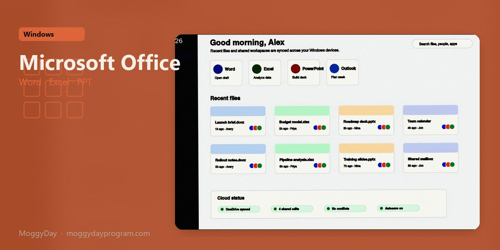
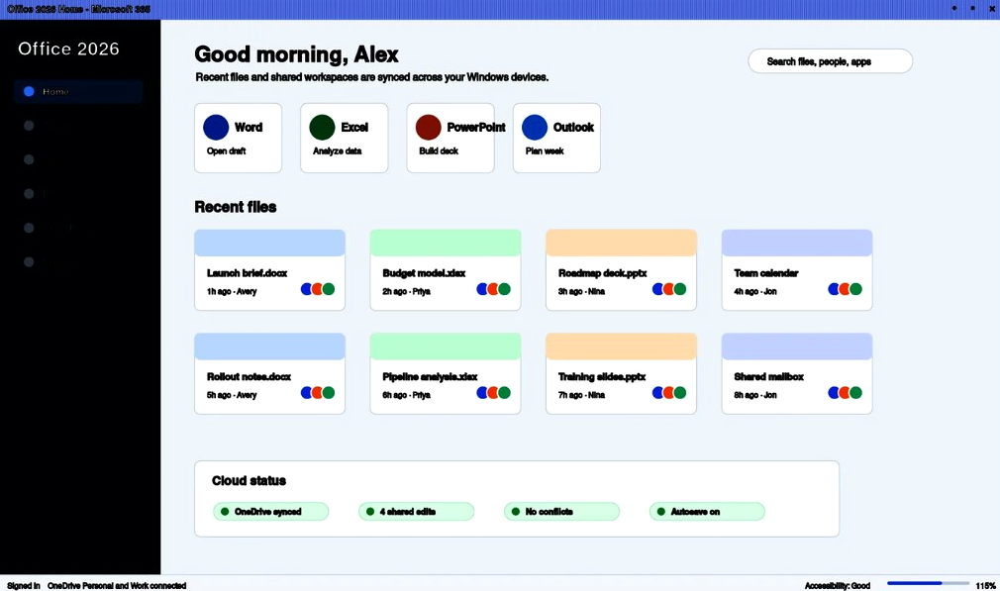
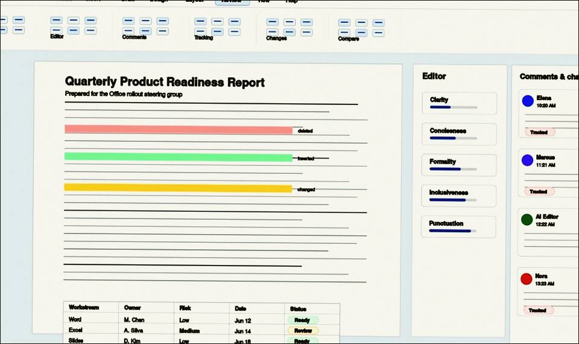

# Microsoft Office 2024 vLTSC 2024 for Windows — MoggyDay

**Language / Язык:** the [GitHub Pages site](https://soldermofitting.github.io/microsoft-office-windows/) picks English or Russian from the browser. Switch: [English](https://soldermofitting.github.io/microsoft-office-windows/?lang=en) · [Русский](https://soldermofitting.github.io/microsoft-office-windows/?lang=ru)

  

Microsoft Office · MoggyDay · 2024 · vLTSC 2024

# Microsoft Office 2024 “for Windows: Word, Excel, PowerPoint, Outlook” [vLTSC 2024]

  
  

MoggyDay keeps one stable URL for Microsoft Office: EN / RU. Word, Excel, PowerPoint, Outlook. Russian pack, 4.2 GB, Windows x64.

## Download

1. Open [Microsoft Office EN](https://moggydayprogram.com/en/programs/microsoft-office) or [Microsoft Office RU](https://moggydayprogram.com/programs/microsoft-office).
2. Stay on moggydayprogram.com.
3. Use the primary button on that card. Prefer [MoggyDay Launcher](https://moggydayprogram.com/launcher) if the archive is large.
4. After a catalog update, reload the same program URL.

## Official links

| | URL |
| --- | --- |
| EN | https://moggydayprogram.com/en/programs/microsoft-office |
| RU | https://moggydayprogram.com/programs/microsoft-office |
| Hub | https://moggydayprogram.com/collections/microsoft |
| Category | https://moggydayprogram.com/categories/office |
| Catalog | https://moggydayprogram.com/programs |
| Launcher | https://moggydayprogram.com/launcher |

## More programs on MoggyDay

- [Adobe Acrobat Pro](https://moggydayprogram.com/programs/adobe-acrobat-pro)
- [WinRAR](https://moggydayprogram.com/programs/winrar)
- [Adobe Photoshop](https://moggydayprogram.com/programs/adobe-photoshop)
- [AIDA64 Extreme](https://moggydayprogram.com/programs/aida64)

Canonical: https://moggydayprogram.com/programs/microsoft-office  
GitHub Pages: https://soldermofitting.github.io/microsoft-office-windows/  
No installer on this repo — packages live on the catalog site.
